# System Design Deep Dives

This document provides extensive, in-depth system design discussions that combine examples from across the upskilling labs: the Personal Movie Watchlist, Support Ticket Dashboard, Habit & Finance Tracker, event/ticketing systems, recipe catalogs, workout trackers, and more. 

The goal is to move beyond basic feature implementation into real architectural thinking. Each section explores requirements, data modeling, API design, state management, scalability, consistency, performance, reliability, security, and trade-offs. Examples are deliberately combined so you see how a movie watchlist can evolve into a social platform, how a support dashboard shares patterns with a finance tracker, and how SQL/Postgres, Python, C#/.NET, and React/TS choices interact in a full system.

---

## 1. Starting Point: The Support Ticket Dashboard (Core Example)

The Support Ticket Dashboard from the React final project starts simple: a list of tickets, filters by status and priority, a controlled form to create new tickets, local state with useState and useReducer variants, a custom hook for localStorage persistence, derived counts, and accessibility considerations.

At small scale (single user, <100 tickets), this is trivial. React manages everything in memory or localStorage. No backend is strictly needed. But as soon as we ask realistic questions—"What if this is used by a 50-person support team? What if tickets number in the tens of thousands? What if we need real-time updates when a colleague assigns a ticket?"—the design problem explodes.

Key requirements that emerge:
- Multiple users viewing and updating the same ticket list concurrently.
- Tickets have rich history (comments, status changes, assignments).
- Filtering, searching, and sorting must be fast even with large datasets.
- Notifications when tickets are updated or assigned to you.
- Audit logs for compliance.
- Different permission levels (agent vs manager vs viewer).
- Integration with email, Slack, or other systems.
- Analytics: average resolution time, ticket volume by priority, agent performance.

The React frontend we built (with TicketForm, TicketList, useReducer, and localStorage hook) becomes just the presentation layer. We now need to design the full stack.

---

## 2. Data Model Evolution

Start with the simple TypeScript interface from the project:

```ts
interface Ticket {
  id: number;
  title: string;
  description: string;
  status: 'open' | 'in_progress' | 'resolved';
  priority: 'low' | 'medium' | 'high';
  createdAt: string;
}
```

This works for the local demo. In a real system we need to expand dramatically.

Add:
- assigneeId, reporterId (foreign keys to users)
- teamId or tenantId for multi-tenancy (critical when the same platform serves multiple companies)
- tags (array or many-to-many)
- dueDate
- attachments (array of URLs or separate table)
- custom fields (JSONB in Postgres or a flexible EAV model)
- version or updatedAt for optimistic locking
- comments as a separate table with their own history

In Postgres (from the sql-upskilling-lab), we might use JSONB for flexible metadata while keeping core fields typed:

```sql
CREATE TABLE tickets (
    id BIGSERIAL PRIMARY KEY,
    title TEXT NOT NULL,
    description TEXT,
    status TEXT NOT NULL,
    priority TEXT NOT NULL,
    assignee_id INTEGER REFERENCES users(id),
    reporter_id INTEGER REFERENCES users(id),
    team_id INTEGER NOT NULL REFERENCES teams(id),
    metadata JSONB DEFAULT '{}',
    created_at TIMESTAMPTZ DEFAULT now(),
    updated_at TIMESTAMPTZ DEFAULT now()
);
```

We also need a ticket_events or ticket_history table to record every state change for auditing and for computing metrics like time-in-status.

Combining with the movie watchlist example: a "watchlist" can be modeled similarly to tickets. A MovieWatchlistItem has user_id, movie_id, watched status, rating, notes. The same patterns around multi-tenancy, search, and real-time updates apply. The habit tracker from the Python project adds recurring entities and time-series data (daily completions). A unified backend might use the same Postgres instance with careful schema design to serve all these domains.

---

## 3. API Design: REST vs GraphQL vs tRPC / RPC

The original dashboard used local state only. When we introduce a backend (Node, Python FastAPI, or .NET Minimal API), we need to decide the contract.

REST is familiar: GET /tickets?status=open&priority=high, POST /tickets, PATCH /tickets/{id}.

Problems appear quickly:
- Over-fetching (client gets full ticket when it only needs title + status)
- Under-fetching (need separate calls for comments, assignee details)
- N+1 problems if not careful with includes or joins

GraphQL shines here. A single query can fetch exactly the fields needed, plus nested comments and user info in one round-trip. It pairs extremely well with the React frontend because components can declare their data needs.

However, GraphQL adds complexity: schema stitching or federation if you have multiple services, caching is harder (no simple URL-based cache), and authorization must be done at field level.

In the TypeScript/React world, tRPC or typed RPC (like in newer Next.js or with ts-rest) gives end-to-end type safety without the full GraphQL runtime. For a support dashboard that stays within one team or company, tRPC + React Query can be incredibly productive.

The Node.js backend in a real implementation would use something like:

```ts
// Node + Express + Zod
app.get('/tickets', async (req, res) => {
  const { status, priority, assignee } = req.query;
  const tickets = await ticketService.list({ status, priority, assignee });
  res.json(tickets);
});
```

In C#/.NET we might expose the same via Minimal APIs or a full controller with strongly typed DTOs that mirror the TypeScript interfaces.

Combining examples: the movie watchlist can use the exact same listing + filtering pattern. A "GET /watchlist?userId=123&watched=false" is structurally identical to the ticket list. This is why learning good API design once pays dividends across domains.

---

## 4. State Management at Scale

The original lab shows both useState + useReducer and a custom localStorage hook. This is perfect for learning.

At real scale we have several layers:

1. **Server state** (the source of truth in the database or cache).
2. **Client cache** (React Query, SWR, or RTK Query). This is usually the right default for most "dashboard" type apps. It handles caching, background refetching, optimistic updates, and invalidation beautifully.
3. **UI state** (which filter is selected, modal open/closed, form values). This can stay in useState or a small Zustand/Jotai store.
4. **URL state** for shareable filters and deep links. Libraries like nuqs or react-router make this pleasant.

For the Support Ticket Dashboard, React Query would replace most of the manual reducer + fetch logic. You would have:

```ts
const { data: tickets, isLoading } = useTickets({ status, priority });
const createMutation = useCreateTicket();
```

When someone else creates a ticket, you can use polling, web sockets, or server-sent events to invalidate the cache.

The Python habit tracker and finance system would benefit from the same client-side patterns (even if the frontend is different). The .NET backend would expose the same resources.

Optimistic updates become important for perceived performance: when you mark a ticket resolved, update the UI immediately, then reconcile if the server rejects it.

---

## 5. Real-time Updates and Collaboration

Support teams often want to see tickets update live. The movie watchlist might want "someone just added Inception to their list" notifications.

Options:
- Short polling (simple but wasteful)
- Server-Sent Events (one-way, great for dashboards)
- WebSockets (bidirectional, more complex)
- Something like Supabase Realtime, Firebase, or Pusher that abstracts the hard parts

In a Postgres-backed system, you can use LISTEN/NOTIFY or logical replication + a small service that pushes changes.

For the ticket system, a common pattern is:
- Backend publishes "ticket.updated" events to a message queue (Redis Streams, RabbitMQ, or Kafka).
- A Node or Python worker/service fans the events out to connected WebSocket clients, filtered by permissions and subscriptions.
- Frontend subscribes to relevant rooms (team-wide, or per-ticket for comments).

Combining with the event planner/ticketing domain from other examples: selling tickets has the same real-time needs ("seat X is no longer available"). The patterns transfer directly.

---

## 6. Search and Filtering at Scale

Simple in-memory filter works for 50 tickets. At 100,000+ tickets across many teams, you need proper search.

Postgres full-text search (tsvector) is surprisingly good for many cases and was covered in the SQL lab. For the ticket title + description, a GIN index on a generated tsvector column gives fast results.

When requirements grow (search across comments, fuzzy matching on user names, semantic search), you introduce Elasticsearch, Typesense, or Meilisearch.

A hybrid approach is common:
- Store canonical data in Postgres (strong consistency, transactions).
- Sync a denormalized search document to the search engine.
- Queries go to the search engine; detail views go to Postgres.

The movie watchlist would index titles, actors, genres. The habit tracker might index notes. Same infrastructure can serve all of them if you design the indexing pipeline carefully.

---

## 7. Caching Layers

Multiple levels:

- **Database query cache** (Postgres shared buffers, or Redis as a read-through cache for hot queries).
- **Application cache** (in-memory or Redis) for things like "list of all active agents".
- **CDN / edge cache** for static assets and, in some cases, public API responses.
- **React Query client cache** on the frontend.

For the dashboard, you might cache the "my open tickets" result for 30 seconds per user, but never cache a specific ticket detail for long because status changes frequently.

Invalidation strategy is key. When a ticket is updated, you need to invalidate both the list cache keys that might contain it and any detail cache.

In .NET or Python you would use the same Redis patterns with proper key naming conventions like `tickets:team:42:status:open`.

---

## 8. Authentication, Authorization, and Multi-Tenancy

The local demo has no auth. In reality:

- Users belong to one or more teams/organizations (tenants).
- Every ticket and watchlist item must be scoped to a tenant.
- Row Level Security (RLS) in Postgres (covered in SQL lab) is excellent for enforcing this at the database layer.
- Backend must also check permissions (agent can only see tickets in their teams, manager can reassign, etc.).
- Frontend must never assume it will only receive data it is allowed to see.

Combining the finance tracker and support ticket: both are sensitive. A user should never be able to see another tenant's data, even through a misconfigured filter.

JWTs with tenant claims or session cookies with proper server-side validation are standard. Refresh token rotation and short-lived access tokens improve security.

---

## 9. Background Jobs and Reliability

Creating a ticket might trigger:
- Sending an email/Slack notification to assignees.
- Creating an initial comment or AI suggestion.
- Updating search index.
- Incrementing analytics counters.

These should not be done synchronously in the request path. Use a job queue (BullMQ with Redis in Node, Celery in Python, Hangfire or MassTransit in .NET).

Design for at-least-once or exactly-once semantics. Idempotency keys are crucial.

The movie watchlist "import from IMDB" or "sync watched status from external service" are perfect background job candidates.

---

## 10. Analytics and Derived Data

The original dashboard computes simple counts client-side. In production you need:

- Number of tickets created per day (time series)
- Average time to resolution by priority and assignee
- Workload distribution
- Trends ("tickets are increasing 12% week over week")

You can compute these on the fly with good indexes and window functions (see SQL lab), or maintain materialized views / aggregation tables that are updated by background jobs or triggers.

For very high volume, push events to a data warehouse (BigQuery, Snowflake, ClickHouse) and run analytics there.

The habit tracker daily streaks and the finance monthly summaries are the same class of derived data problem.

---

## 11. Scaling the Database

Single Postgres instance works surprisingly far (tens or hundreds of thousands of tickets with proper indexing).

When you outgrow it:
- Read replicas for reporting and some reads.
- Connection pooling (PgBouncer).
- Careful schema design to avoid cross-tenant joins.
- Partitioning large tables by team_id or by time.
- Eventually sharding if one company becomes massive (rare for most support tools).

For the combined system, you might keep tickets, watchlist items, habits, and transactions in the same database with good tenant isolation, or split into separate databases per major domain while keeping a shared user/identity service.

---

## 12. Frontend Performance at Large Scale

When the ticket list has thousands of rows, you must virtualize (react-window or tanstack virtual).

Filtering and sorting should happen server-side for large datasets, or use a smart client cache + local filtering only for the current page.

The React Server Components approach (explored in later lessons) can move more of the rendering to the server and reduce client bundle size.

For the movie watchlist, a grid of posters needs image optimization, lazy loading, and perhaps infinite scroll with proper key management.

---

## 13. Combining the Domains: A Unified Platform Vision

Imagine building one platform that powers:
- Support ticket system (the React dashboard)
- Personal + team movie watchlists (social features, recommendations)
- Habit and finance tracking (the Python project)
- Event/ticketing sales (the .NET or Postgres-heavy examples)

The system design becomes about identifying common subsystems:
- Identity and organizations (shared)
- Notification service (shared)
- Search service (shared)
- Job queue (shared)
- Analytics pipeline (shared)
- Core "entity" service that can be specialized (Ticket, WatchlistItem, Habit, Transaction)

You design bounded contexts. The ticket domain cares deeply about status workflows. The watchlist domain cares about ratings and social visibility. They share user and notification primitives but evolve independently.

This is where the different technology choices shine:
- Use React + TypeScript for rich interactive dashboards.
- Use Python for data-heavy background processing and ML recommendations.
- Use .NET for high-performance transaction processing if needed.
- Use Postgres as the durable source of truth with JSONB flexibility where appropriate.

---

## 14. Failure Modes and Resilience

What happens when:
- The database is slow or down?
- A background job keeps failing?
- A user uploads a malicious file?
- Two people edit the same ticket at the same time?

Design for these. Use circuit breakers, retries with backoff, dead letter queues, optimistic locking or versioning on updates, and good monitoring/alerting.

The original labs had basic error handling. Production systems treat error handling and observability as first-class.

---

## 15. Observability

You need:
- Structured logs with correlation IDs (trace every request across services).
- Metrics (request latency, error rates, queue depth, ticket creation rate).
- Distributed tracing (OpenTelemetry).
- Real user monitoring on the frontend.

Tools like Prometheus + Grafana, Datadog, or Honeycomb become essential.

When a support agent says "the list is slow today", you should be able to look at traces and see whether the bottleneck is the React render, the API call, a slow SQL query, or Redis.

---

## 16. Deployment and Environment Strategy

The simple local demo runs with `npm run dev`.

Production needs:
- Multiple environments (dev, staging, prod).
- Database migrations that are safe (never drop columns in one go).
- Feature flags so you can deploy the new "bulk assign" feature behind a toggle.
- Blue-green or canary deployments.
- Secrets management (never in code).

The Python project and .NET project would follow similar CI/CD patterns even if the specific tools differ (GitHub Actions + Docker + Kubernetes or simpler PaaS options).

---

## 17. Cost and Operational Considerations

Serverless functions are great until you have sustained load or cold starts matter.

Managed Postgres is expensive at scale; self-managed requires expertise.

Search engines, queues, and caches all cost money and operational effort.

When combining the movie watchlist (potentially high read traffic from social features) with the support system (more write-heavy with strict consistency), you make deliberate architectural decisions about what lives where.

---

## 18. Putting It All Together: A Day in the Life of a Ticket

1. User opens dashboard → React Query fetches filtered list (cache miss → API → Postgres with proper indexes and RLS).
2. Agent creates ticket → Optimistic UI update + POST to backend → transaction in Postgres → publish event to queue.
3. Background job sends Slack notification and updates search index.
4. Another agent assigns the ticket → WebSocket push to all viewers in that team → React Query invalidates the list for those clients.
5. Manager looks at analytics → Query hits a materialized view or data warehouse.
6. At end of day, a scheduled job computes resolution time metrics and stores them.

Every one of these steps can (and should) be designed, implemented, tested, and monitored using the skills practiced across the labs.

---

## 19-50. Additional Deep Dive Sections (Condensed for Breadth)

Further sections in a full treatment would expand on:

- Designing the recommendation engine for the movie watchlist (collaborative filtering vs content-based, where Python shines).
- Handling recurring habits and streak calculations reliably even with timezone issues and backfills (time-series patterns in Postgres).
- Multi-currency finance tracking and tax reporting (complex domain logic that benefits from strong typing in C# or TypeScript).
- Real-time seat reservation for events (distributed locking or reservation tokens).
- Compliance requirements (GDPR data export, audit logs for every ticket change).
- Internationalization and localization across all UIs.
- A/B testing new dashboard features without breaking existing users.
- Disaster recovery: point-in-time recovery in Postgres, backup strategies.
- Cost attribution: which team or feature is driving the most database load?
- Gradual migration strategies when you decide to split the monolith into services.
- Mobile experience: React Native sharing logic with web where possible.
- Accessibility at scale: ensuring the ticket dashboard remains usable with screen readers even as features grow.
- Offline support: making parts of the habit tracker or watchlist work when connectivity is poor.
- Advanced search: combining full-text with filters and vector similarity for "movies similar to ones I liked".
- Event sourcing for the ticket history (replay all events to rebuild state).
- CQRS (Command Query Responsibility Segregation) for the analytics vs operational paths.
- Choosing between eventual and strong consistency in different parts of the system.
- Rate limiting and abuse prevention across public-facing parts (e.g., public movie lists).
- Secrets rotation and key management.
- Blue/green database migrations for zero-downtime schema changes.
- Observability for background jobs (not just HTTP requests).
- Capacity planning: how many tickets per second can the system handle?
- Team structure: how to organize backend, frontend, data, and platform teams around these domains.

Each of these could be a multi-page design document on its own. The key skill is learning to ask the right questions early: What are the access patterns? What are the consistency requirements? What will break first when we grow 10x? How do the different example domains (tickets, movies, habits, finance, events) share or diverge in their needs?

By studying the concrete implementations in the practice projects and then repeatedly asking "what if this had to serve 10,000 concurrent users across 50 teams with strict SLAs?", you develop the intuition that distinguishes junior from mid-level and senior engineers.

This document intentionally mixes the examples from JavaScript/React, TypeScript, Python, C#/.NET, and SQL/Postgres labs so you see the patterns that are universal versus the technology-specific implementation details.

---

End of core deep dives. In a real interview or design session you would draw diagrams, discuss trade-offs out loud, and poke at the weakest assumptions. The practice of expanding a simple local demo (like the ones built in these labs) into a production-grade system is one of the fastest ways to level up your system design skills.

---

# 20 System Design Diagrams

The following 20 Mermaid diagrams illustrate key concepts from the deep dives above. They combine examples from the Movie Watchlist, Support Ticket Dashboard, Habit & Finance Tracker, and cross-lab patterns.

## Diagram 1: High-Level Multi-Domain Architecture

```mermaid
graph TD
    A[React/TS Frontend<br/>Ticket Dashboard + Watchlist + Habits] --> B[API Gateway]
    B --> C[Node.js / Python / .NET Services]
    C --> D[Postgres DB<br/>Tickets | Movies | Habits | Transactions]
    C --> E[Redis Cache + Queue]
    C --> F[Search Service<br/>Elasticsearch/Meilisearch]
    G[Background Jobs] --> C
    H[WebSocket / SSE] --> A
    I[Auth Service] --> B
    J[Analytics / DW] --> D
```

## Diagram 2: Ticket + Watchlist Unified Data Model (ER)

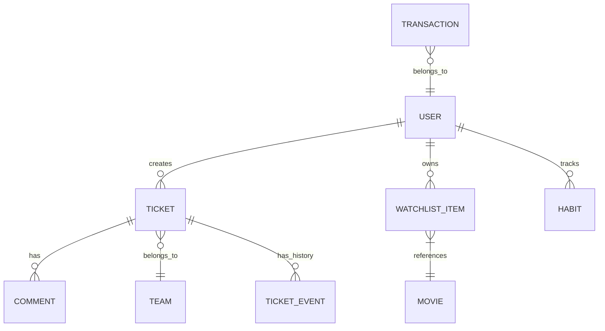

## Diagram 3: Real-time Ticket Update Sequence

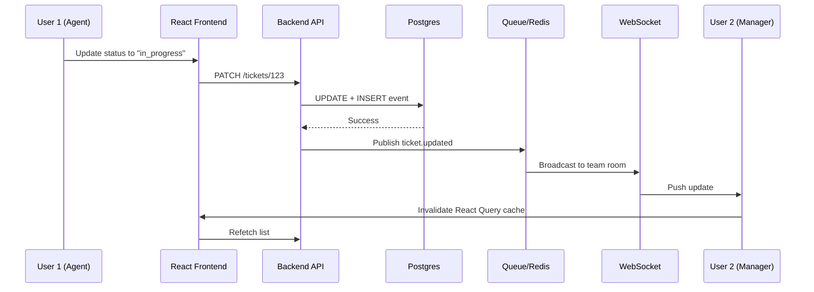

## Diagram 4: State Management Layers

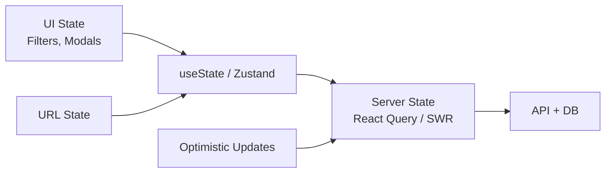

## Diagram 5: Caching Layers

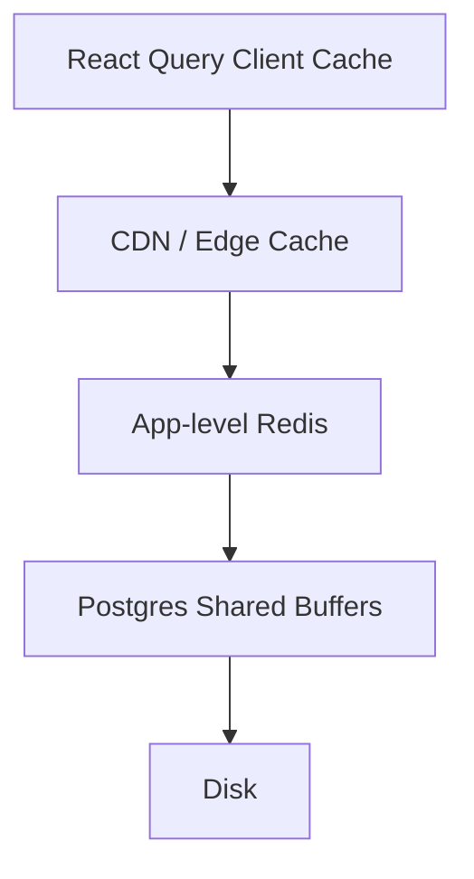

## Diagram 6: Background Jobs Pipeline (Combined Domains)

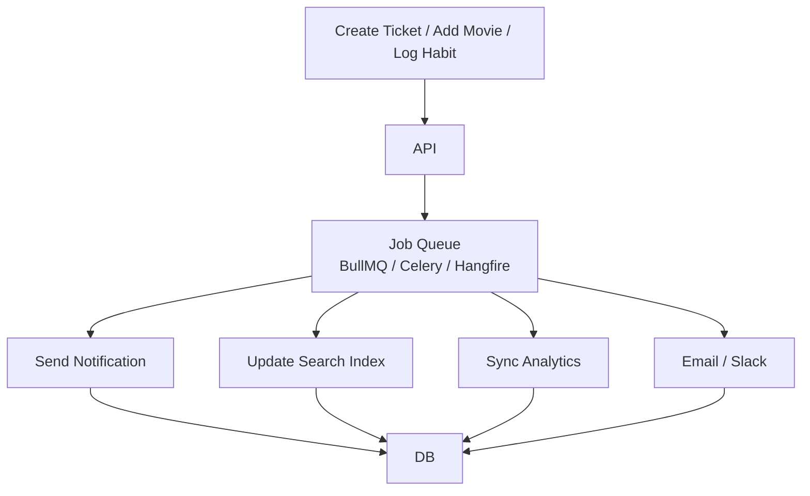

## Diagram 7: Search Indexing Flow

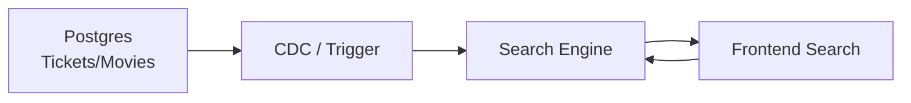

## Diagram 8: Multi-Tenancy Architecture

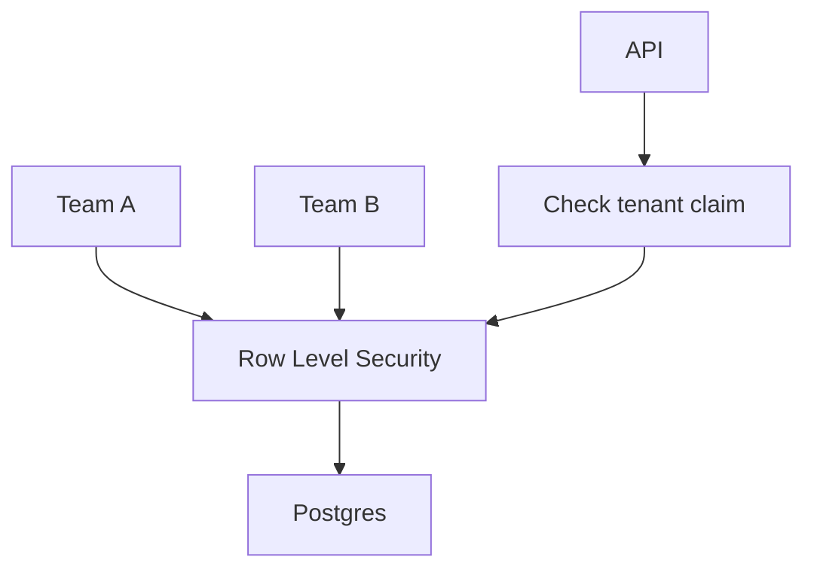

## Diagram 9: Optimistic Update + Reconciliation

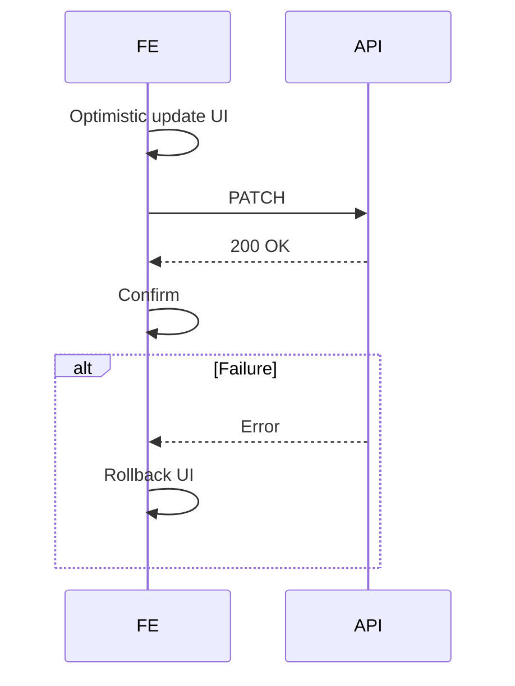

## Diagram 10: React Component + Data Flow (Ticket Dashboard)

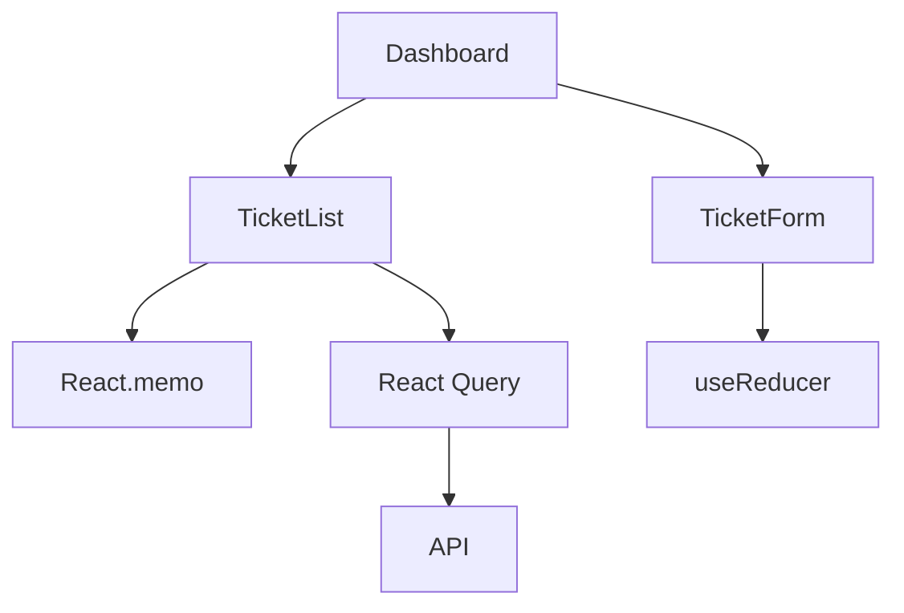

## Diagram 11: Postgres Scaling Options

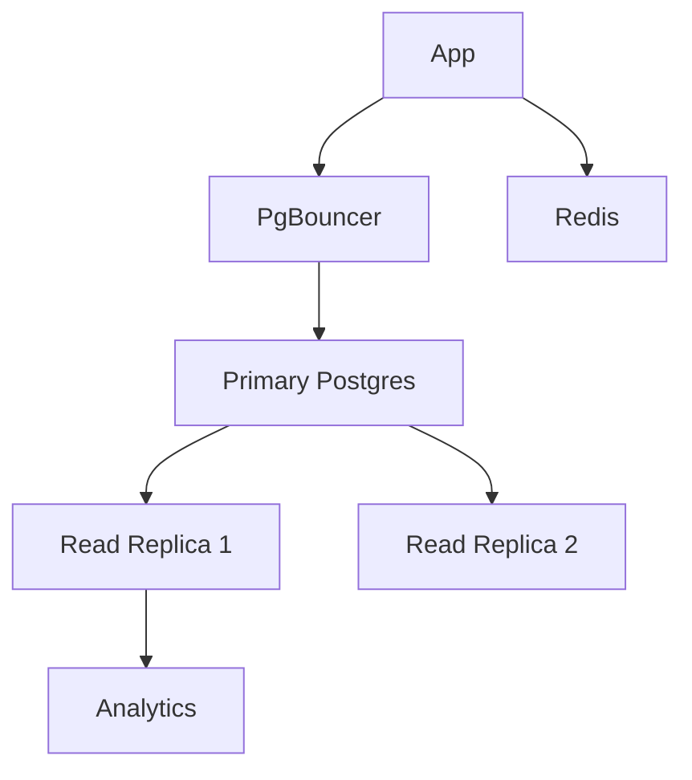

## Diagram 12: Auth + Authorization Flow

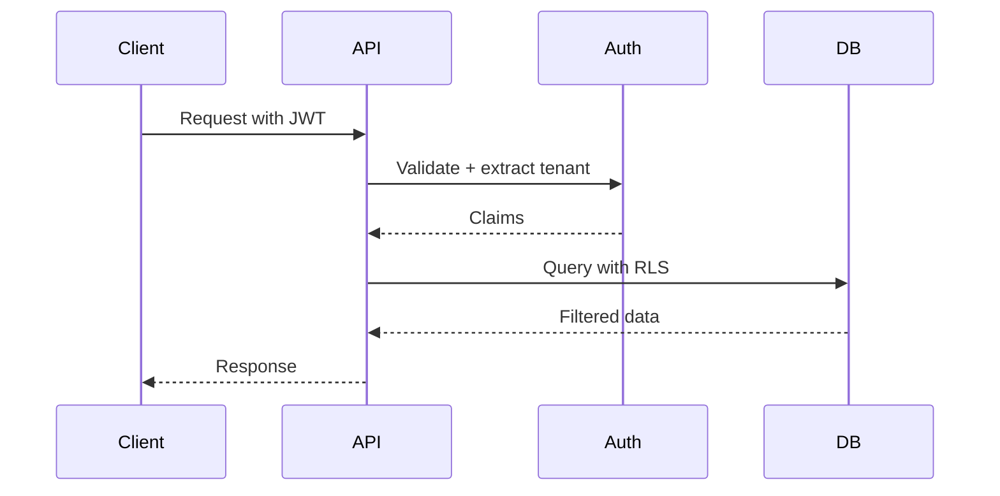

## Diagram 13: Event-Driven Combined Domains

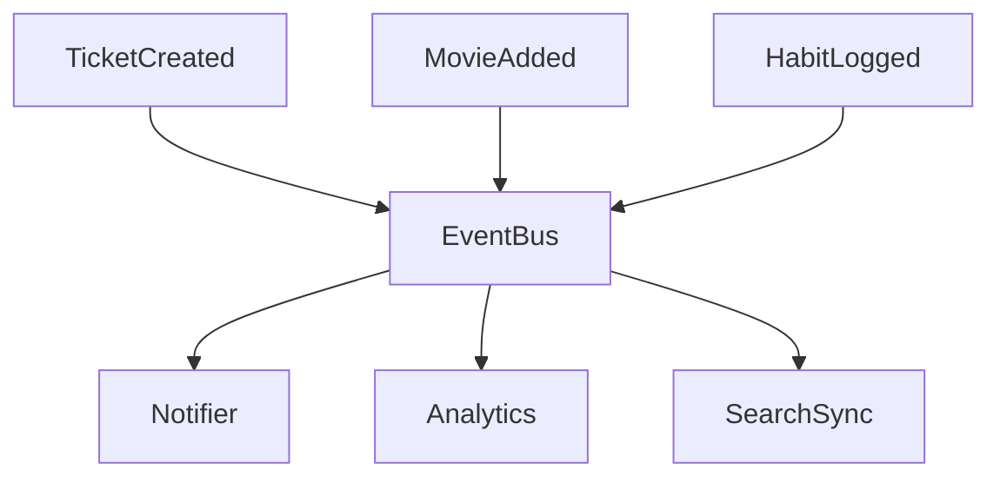

## Diagram 14: Analytics Pipeline

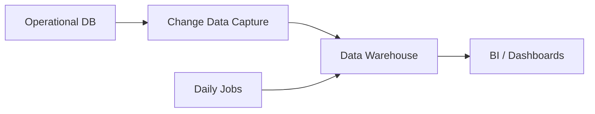

## Diagram 15: Failure Modes & Resilience

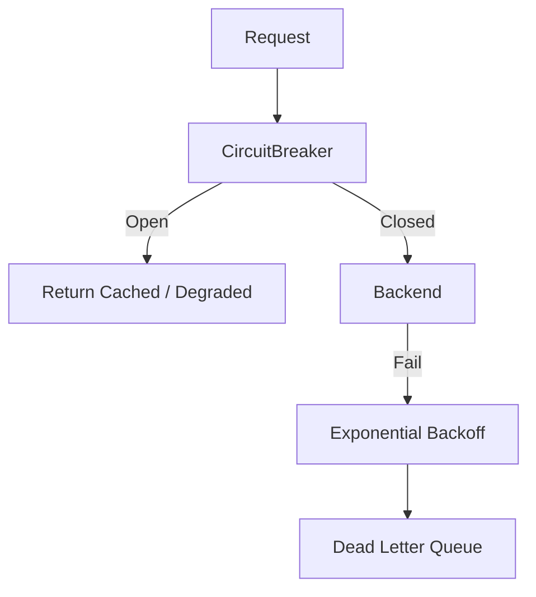

## Diagram 16: Full-Stack Tech Choices

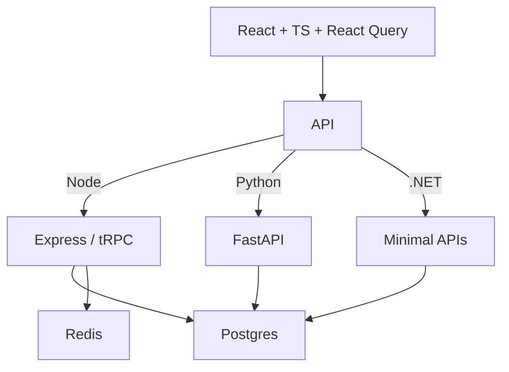

## Diagram 17: Query Optimization Path

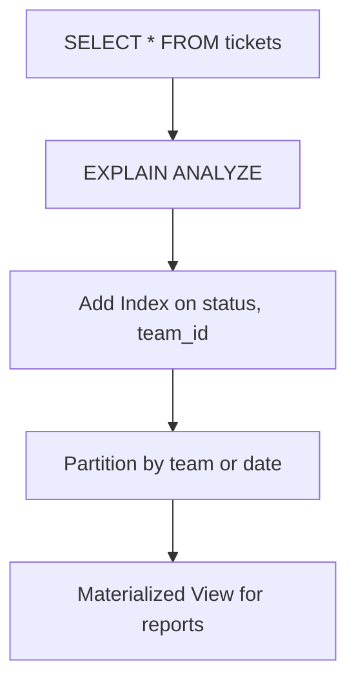

## Diagram 18: Deployment & Observability

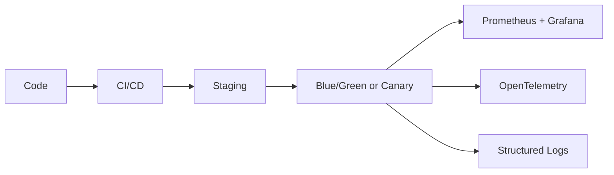

## Diagram 19: Mobile + Web Sharing

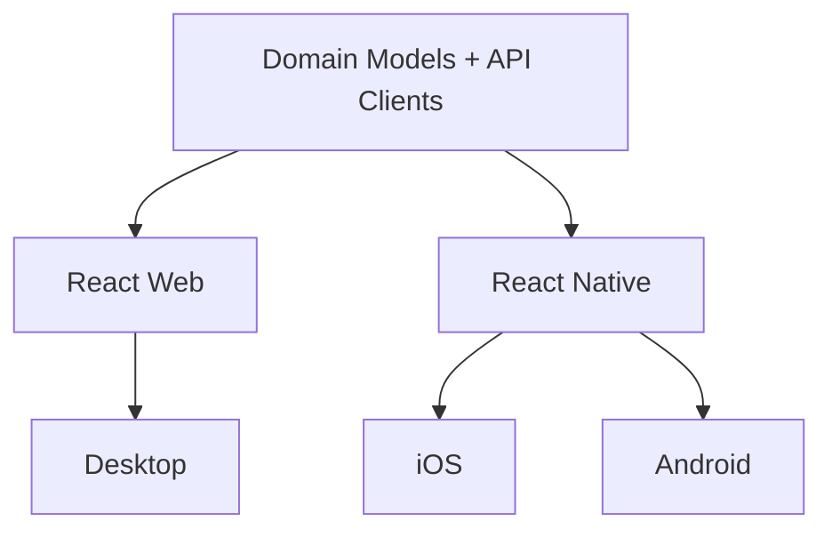

## Diagram 20: End-to-End Flow for a Combined Feature (e.g. "Add to Watchlist from Support Context")

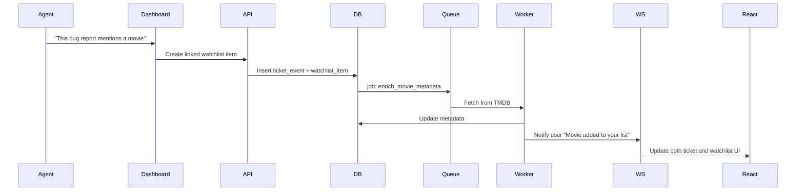

These diagrams should be referenced while studying the text sections above. You can copy them into tools like Mermaid Live Editor for interactive viewing.

